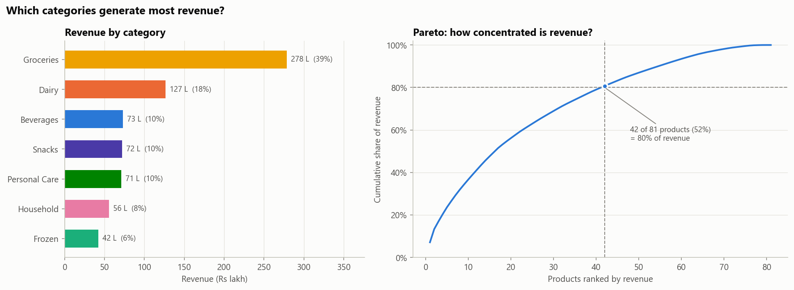
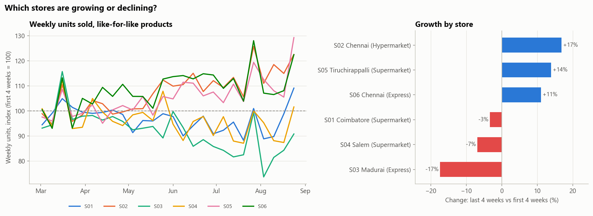
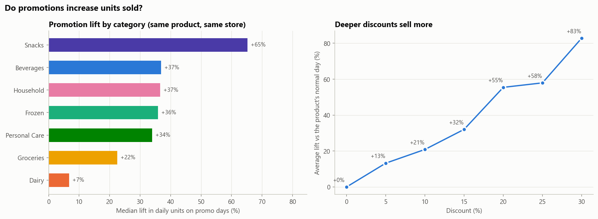
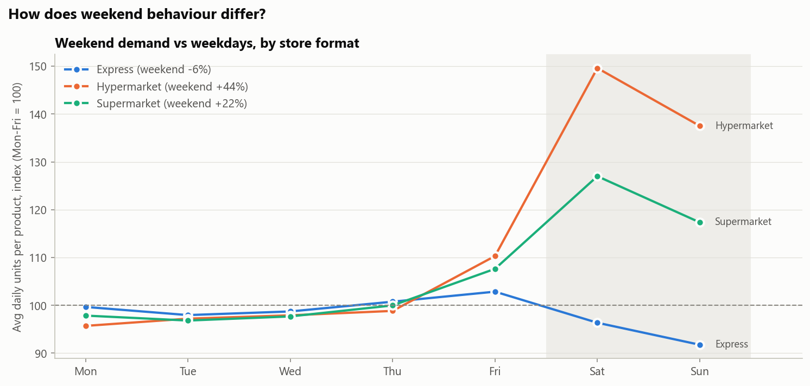
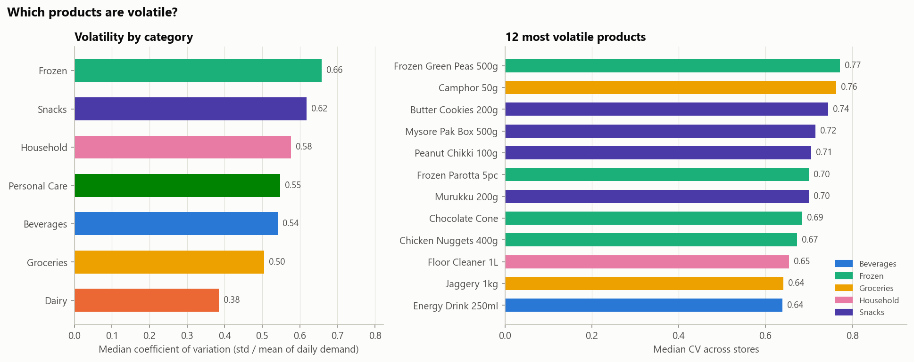
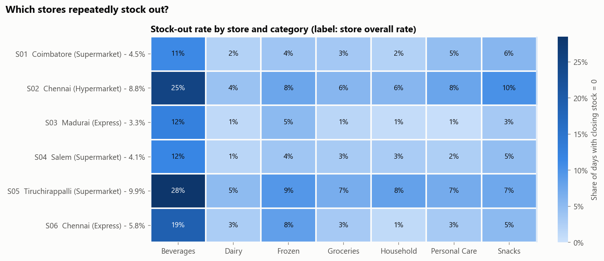
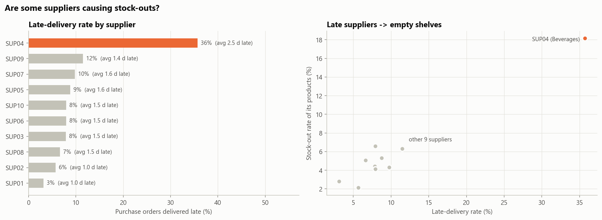
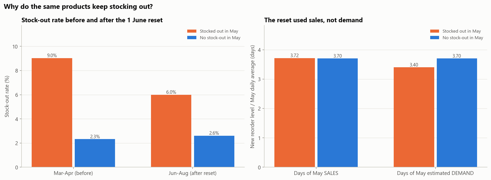
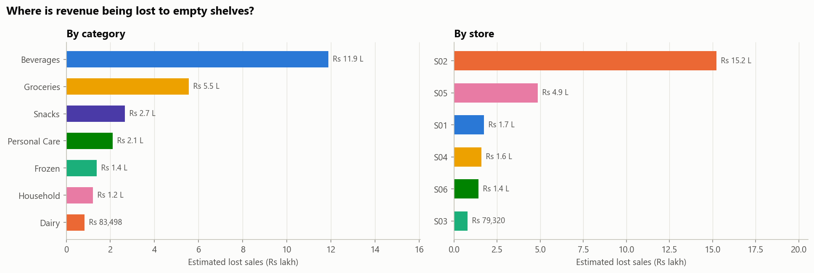
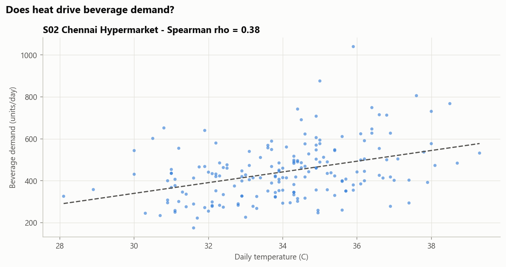

# EDA - Business Insights

_Generated by `src/eda_stats.py` from `data/processed/master_dataset.csv`. Every number below is computed, not typed._

## Headline KPIs (1 Mar - 31 Aug 2026)

| KPI | All stores | Definition |
|---|---|---|
| Revenue (Rs) | Rs 7.19 Cr | Sum(quantity x selling price) over clean sale lines |
| Units Sold | 1,045,974 | Sum of quantity (returns excluded) |
| Gross Margin (Rs) | Rs 1.51 Cr | Revenue - units x cost_price |
| Stock-out Rate | 6.3% | Store-product-days with closing stock = 0 / all store-product-days |
| Inventory Turnover (period) | 51.0 | COGS / average daily inventory value at cost, over 1 Mar - 31 Aug |
| Inventory Turnover (annualised) | 101.2 | Period turnover x 365 / 184 |
| Days of Inventory (31 Aug) | 3.6 | Closing stock on 31 Aug / average daily demand of the last 28 days |
| Inventory Value at Cost, 31 Aug (Rs) | Rs 13.5 L | Closing stock x cost_price on the last day |
| Promotion Lift | 12.7% | (mean daily units on promo days - on non-promo days) / non-promo (pooled; see test T1 for the paired version) |
| Estimated Lost Sales (Rs) | Rs 25.6 L | (demand_est - units_sold) x unit price on stock-out days |
| Lost Sales as % of Revenue | 3.6% | Estimated lost sales / revenue |
| Returned Units | 3,932 | Units on quantity <= 0 lines |

Per-store KPIs: `reports/kpi_summary.csv`.

### Monthly trend

| Month | Revenue | MoM growth | Units | Stock-out rate | Est. lost sales |
|---|---|---|---|---|---|
| 2026-03 | Rs 1.17 Cr | - | 170,746 | 6.7% | Rs 3.9 L |
| 2026-04 | Rs 1.12 Cr | -4.0% | 164,529 | 7.7% | Rs 4.3 L |
| 2026-05 | Rs 1.20 Cr | +7.3% | 175,518 | 8.2% | Rs 6.3 L |
| 2026-06 | Rs 1.16 Cr | -4.0% | 170,950 | 4.9% | Rs 3.6 L |
| 2026-07 | Rs 1.21 Cr | +4.8% | 174,344 | 4.1% | Rs 2.9 L |
| 2026-08 | Rs 1.33 Cr | +10.3% | 189,887 | 6.3% | Rs 4.6 L |

## Insights (one business question per chart)

### 1. Which categories generate most revenue?

Groceries (39%) and Dairy (18%) bring in 56% of revenue; Frozen is smallest (6%). Revenue is NOT a classic 80/20 pattern - it is spread widely: it takes 42 of 81 products (52%) to reach 80%, although the top 10 alone give 37%. Top products: Ponni Rice 5kg, Milk 1L, Sunflower Oil 1L, Ghee 500ml, Idli Batter 1kg. Action: the top 10 deserve the tightest availability targets and daily stock checks, but a broad range matters, so replenishment must work for the whole catalogue, not only a few hero SKUs.

### 2. Which stores are growing or declining?

Like-for-like weekly units (last 4 weeks vs first 4): fastest growth S02 (+17%), then S05 (+14%); weakest S03 (-17%). Action: reorder levels set on old sales under-stock growing stores and over-stock declining ones - growth must be a forecasting feature, and S03's stock should be trimmed.

### 3. Do promotions increase units sold?

Yes. For the same product in the same store, promo days sell a median +29% more units (93% of 375 store-product pairs gain). Lift is highest in Snacks (+65%) and lowest in Dairy (+7%); it rises with discount depth (5% off: +13%, 30% off: +83%). But the stock-out rate is 13.6% on promo days vs 5.2% otherwise - promotions are not being stocked for. Action: raise the order before every planned promotion by the category's expected lift.

### 4. How does weekend behaviour differ?

The weekend effect depends on the format: Hypermarket +44%, Supermarket +22%, Express -6% vs weekdays (peak day: Express Fri, Hypermarket Sat, Supermarket Sat). Action: hypermarket/supermarket deliveries should land by Friday; a single weekly pattern for all stores would be wrong.

### 5. Which products are volatile?

Frozen is the most volatile category (median CV 0.66) and Dairy the most stable (0.38). Most volatile products: Frozen Green Peas 500g, Camphor 50g, Butter Cookies 200g. Part of this is size: slow sellers look volatile from counting noise (Spearman rho between mean demand and CV = -0.65). Volatile beyond what their size explains: Potato Chips 52g at S02, Cola 750ml at S02, Packaged Water 1L at S02. Action: safety stock must scale with each product's volatility, not a flat percentage.

### 6. Which stores repeatedly stock out?

Stock-outs are concentrated: worst store S05 (9.9%) and S02 (8.8%) vs best S03 (3.3%). Beverages stock out on 18% of days - 3.8x the other categories' average. Worst cells: S05-Beverages 28%, S02-Beverages 25%, S06-Beverages 19%. Action: Beverages needs a supply fix (see supplier chart), not just higher reorder levels.

### 7. Are some suppliers causing stock-outs?

SUP04 (Beverages) delivers 36% of orders late vs 7% for all other suppliers, and its products stock out on 18% of days vs 5% average for the rest. Action: plan SUP04 orders on its real (longer) lead time, hold extra safety stock and escalate with the supplier.

### 8. Why do the same products keep stocking out?

On 1 June every reorder level was reset to about 3.7 days of May *sales* - one rule for all. For products that ran out in May, sales were capped by the empty shelf, so the new level covers only 3.40 days of estimated demand vs 3.70 for the rest. Their levels did rise (median +23%) and stock-outs fell from 9.0% to 6.0% - but they still stock out 2.3x as often as the rest (2.6%). The fix under-corrected because it was based on sales. (Our demand estimate is conservative, so the true shortfall in cover is larger.) Action: plan from estimated demand (demand_est), never from raw sales.

### 9. Where is revenue being lost to empty shelves?

Estimated lost sales: Rs 25.6 L over 6 months (3.6% of revenue) - a conservative figure, because demand beyond an empty shelf is only partly visible. Beverages alone accounts for 46%; S02 is the store losing most (Rs 15.2 L). Action: prioritise the action list by rupees at risk, not by alphabetical order or probability alone.

### 10. Does heat drive beverage demand?

Yes - in S02, each extra degree adds about 26 beverage units a day (rho = 0.38). Beverage stock-outs peak in May (22% of days); Chennai is hottest in June (36.2 C). Action: include the weather forecast in beverage orders (see test T4 for all stores).
