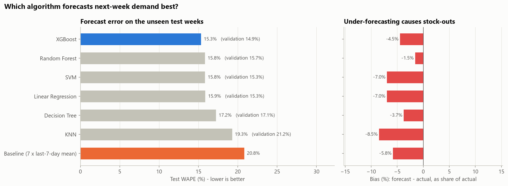
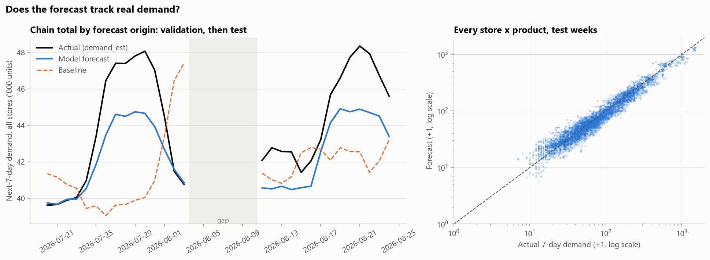
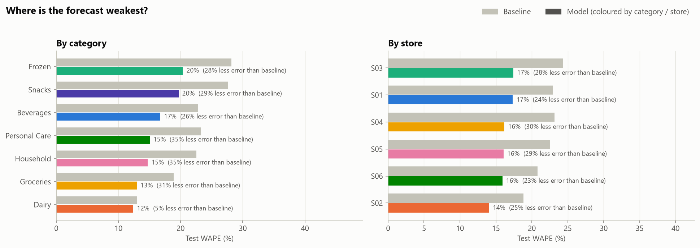
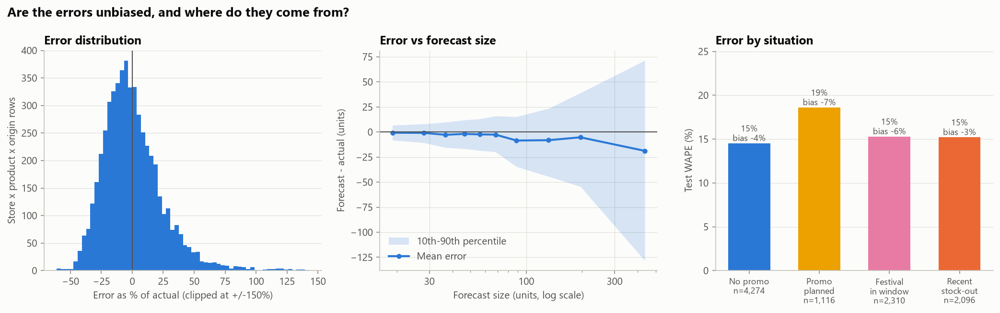
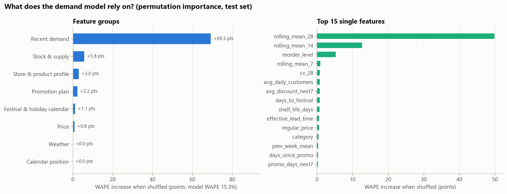
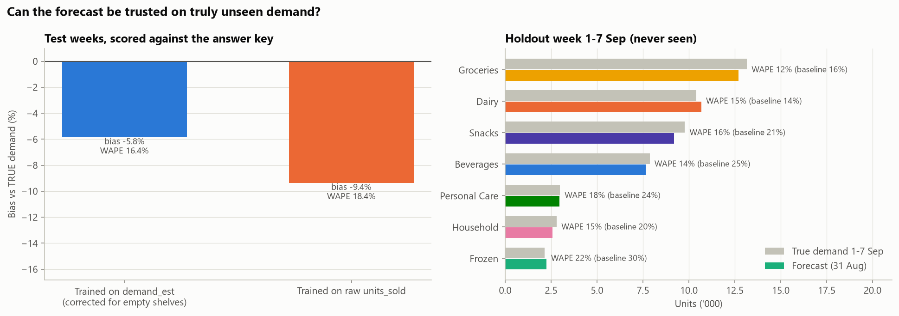

# Model 1 - 7-day demand forecast

*Generated by `src/train_forecast.py`; every number below is computed, not typed.*

## Summary

- **Selected model: XGBoost** (squared error on log target, max_depth=5, min_child_weight=10, trees=727).
- On the unseen test weeks it has **WAPE 15.3%** versus 20.8% for the mandatory baseline (7 x last-7-day mean): **26% less error**. R2 0.950, bias -4.5%.
- Chosen on validation WAPE, the rule fixed before training. The test set was scored once, after tuning was finished.
- On the holdout week 1-7 Sep (true demand from the answer key, never used for training), WAPE is **14.7%** vs 19.3% for the baseline.

## Problem set-up

| Item | Choice | Why |
|---|---|---|
| Prediction moment | Close of day *t*, for every store x product | When a manager can still raise an order |
| Target | `next_7_day_demand` = sum of `demand_est` over *t+1..t+7* | `demand_est` corrects sales on stock-out days; raw sales would teach the model that stores which run out have low demand |
| Model scope | One global model for all 387 store x product combinations | ~150 training days per combination is too little for separate models; a global model shares learning (e.g. promotions lift snacks) and can forecast new products from their store / category |
| Features | 61 features in 8 groups - see `feature_dictionary.md` | Only information known at close of day *t*; proven by `check_no_leakage()` |

## Time-aware split

| Split | Forecast origins | Target windows end | Rows |
|---|---|---|---|
| Train | 2026-03-08 .. 2026-07-12 | 2026-07-19 | 47,879 |
| Validation | 2026-07-20 .. 2026-08-03 | 2026-08-10 | 5,655 |
| Test | 2026-08-11 .. 2026-08-24 | 2026-08-31 | 5,390 |
| Final forecast | 2026-08-31 | predicts 1-7 Sep | 387 |

No random shuffling. Between splits there is a **7-day gap in origins**: a training row with origin 12 Jul has a target covering 13-19 Jul, so validation starts on 20 Jul. Without the gap, validation days would sit inside training targets (leakage through the label). The first week of March is warm-up so every row has at least 7 days of history.

## Which metric matters most to the business

All required metrics are reported (MAE, RMSE, MAPE, R2), but the model is **selected on WAPE** (sum of absolute errors / sum of actual demand), with **bias** as the second check.

- **WAPE** weights each error by volume, so it tracks money and replenishment effort. It is also comparable across stores and categories.
- **MAPE** explodes on slow movers (actual 2, forecast 4 = 100% error) and would push the model to optimise the least important products. On the test set the selected model's MAPE is 18% while its WAPE is 15%: most of that MAPE comes from items selling a handful of units a week.
- **Bias** matters because a model that systematically under-forecasts causes stock-outs even when its MAE looks good. Safety stock absorbs random error, not a systematic shortfall.
- **RMSE** is dominated by the few largest items (hypermarket milk sells ~1,300 units a week), and **R2** is high for any sensible model because it is inflated by the spread between large and small items.

## Model comparison

Best configuration of each permitted algorithm, tuned on validation, then refitted on train + validation and scored once on test:

| index | algorithm | config | Validation WAPE | Test WAPE | MAE | RMSE | MAPE | R2 | Bias |
|---|---|---|---|---|---|---|---|---|---|
| 1 | XGBoost | squared error on log target, max_depth=5, min_child_weight=10, trees=727 | 14.9% | 15.3% | 17.8 | 34.2 | 18.3% | 0.950 | -4.5% |
| 4 | Random Forest | max_depth=18, min_samples_leaf=2, max_features=0.33 | 15.7% | 15.8% | 18.4 | 34.8 | 19.9% | 0.948 | -1.5% |
| 2 | SVM | linear kernel, C=0.1 | 15.3% | 15.8% | 18.4 | 35.2 | 18.3% | 0.947 | -7.0% |
| 3 | Linear Regression | OLS on log target | 15.3% | 15.9% | 18.4 | 35.6 | 18.2% | 0.946 | -7.0% |
| 5 | Decision Tree | max_depth=8, min_samples_leaf=20 | 17.1% | 17.2% | 20.0 | 39.6 | 21.1% | 0.933 | -3.7% |
| 6 | KNN | k=10, distance-weighted | 21.2% | 19.3% | 22.4 | 42.7 | 22.6% | 0.922 | -8.5% |
| 0 | Baseline (7 x last-7-day mean) | no training | 22.7% | 20.8% | 24.2 | 44.8 | 25.9% | 0.914 | -5.8% |

**Not used:** Naive Bayes - it is a classifier, and this is a regression problem.

### Why this model

- Lowest validation WAPE of the six algorithms (14.9%); the runner-up, SVM, had 15.3%.
- The ranking held on test: XGBoost 15.3% vs Random Forest 15.8%, so the choice was not a validation fluke.
- The margin over the next models is modest (0.5 WAPE points on test). Most of the gain over the baseline comes from the features (corrected demand, the promotion plan, the festival calendar), which every model shares. The algorithm choice is the smaller lever.
- XGBoost handles the mix of feature types (counts, ratios, flags, categories) without scaling, learns interactions such as promotion x category without them being hand-coded, and handles missing history natively (new products have NaN lags).
- It is fast: one fit on ~64k rows takes seconds, so the rolling refits for Model 2 and a daily production refit are cheap. Random Forest is close in accuracy but slower and cannot extrapolate beyond the range it saw (e.g. a growing store). KNN and the RBF-kernel SVM trail because distances over 60 mixed features are not meaningful, and a single Decision Tree is too coarse.
- Its bias (-4.5% on test) is a mild under-forecast. It is not fixed by choosing a less biased model on validation: bias measured on one 15-day window proved unstable (see WORKLOG). Instead the out-of-time error profile (`bias_units`, `sigma_7d`) goes to the safety-stock calculation.

Full tuning log (44 configurations): `reports/model1_tuning_log.csv`.

## Does it track real demand?

## Where is it weakest?

| category_name | rows | WAPE | Bias | Baseline WAPE | Improvement vs baseline |
|---|---|---|---|---|---|
| Beverages | 756 | 16.7% | -9.1% | 22.8% | +26% |
| Dairy | 728 | 12.4% | -4.3% | 13.0% | +5% |
| Frozen | 364 | 20.4% | +1.2% | 28.2% | +28% |
| Groceries | 1680 | 13.0% | -3.0% | 18.9% | +31% |
| Household | 518 | 14.7% | +0.7% | 22.6% | +35% |
| Personal Care | 518 | 15.0% | +1.7% | 23.2% | +35% |
| Snacks | 826 | 19.7% | -7.4% | 27.7% | +29% |

| store_id | rows | WAPE | Bias | Baseline WAPE | Improvement vs baseline |
|---|---|---|---|---|---|
| S01 | 980 | 17.4% | -10.2% | 22.9% | +24% |
| S02 | 1106 | 14.1% | -3.4% | 18.9% | +25% |
| S03 | 672 | 17.4% | -4.5% | 24.4% | +28% |
| S04 | 980 | 16.2% | -2.7% | 23.1% | +30% |
| S05 | 980 | 16.1% | -3.7% | 22.5% | +29% |
| S06 | 672 | 15.9% | -4.7% | 20.8% | +23% |

**New products (sparse history).** 2 products launched in August appear in the test weeks with 2-15 days of history (112 rows). Model WAPE 28.2% (bias -27.1%) vs baseline 34.1% (bias -33.8%). The global model needs no separate fallback: missing lags are NaN, and it leans on store type, category, price and the few days of history it has. The two products launched on 27 Aug have only 5 days of history at the final forecast, so treat their forecast as indicative and review it after the first week.

## Residual analysis

Mean error -5.2 units per row (bias -4.5%); the forecast is above actual on 44% of rows. The spread of the error grows with the size of the forecast (middle panel), so safety stock should scale with volume and volatility. This is why the recommendation layer uses a per-item error sigma (`forecast_error_by_combo.csv`), not a fixed percentage. Right panel: promotion and festival weeks are harder to forecast than normal weeks, and items that stocked out recently are hardest, because their recent demand is itself an estimate.

## What the model relies on

Permutation importance on the **test** set: each feature group is shuffled across rows and the increase in WAPE is measured. This shows what the model really uses on unseen data (built-in gain importance favours features with many split points).

| index | Feature group | WAPE increase (points) |
|---|---|---|
| 0 | Recent demand | 69.3 |
| 5 | Stock & supply | 5.76 |
| 6 | Store & product profile | 2.98 |
| 1 | Promotion plan | 2.23 |
| 2 | Festival & holiday calendar | 1.12 |
| 4 | Price | 0.84 |
| 3 | Weather | 0.04 |
| 7 | Calendar position | 0 |

**Recent demand** dominates (+69.3 WAPE points when shuffled): next week looks like last few weeks. The next groups tell the model *how this week will differ*: stock & supply (+5.8), store & product profile (+3.0), promotion plan (+2.2). `reorder_level` ranks high among single features because it is the planners' own demand estimate for the item (known at *t*), a useful second opinion on its level. Groups near zero add little on top of the others; they are kept because they cost nothing and matter for specific items (e.g. weather for beverages and ice cream).

## Scored against the answer key (evaluation only)

The answer key holds the simulator's *true* demand. It was not used for training, tuning or model selection. It is only used here, after everything else was fixed, to check two claims.

**1. Correcting for empty shelves matters.** Same algorithm and settings, trained on two different targets, scored against true demand in the test weeks:

| Model | WAPE | MAE | Bias |
|---|---|---|---|
| Model trained on demand_est (ours) | 16.4% | 19.3 | -5.8% |
| Same model trained on raw units_sold | 18.4% | 21.6 | -9.4% |

The targets themselves: `demand_est` is off true 7-day demand by -1.4%, raw sales by -4.4%.

**2. The forecast holds on a truly unseen week.** Forecast made from origin 31 Aug for 1-7 Sep:

| Forecast | WAPE | MAE | R2 | Bias |
|---|---|---|---|---|
| Model (origin 31 Aug) | 14.7% | 18.7 | 0.956 | -2.4% |
| Baseline | 19.3% | 24.5 | 0.932 | -7.0% |

| category | True demand | Forecast | WAPE | Baseline WAPE |
|---|---|---|---|---|
| Beverages | 7,875 | 7,652 | 13.9% | 24.9% |
| Dairy | 10,403 | 10,683 | 15.0% | 14.2% |
| Frozen | 2,148 | 2,247 | 21.6% | 30.5% |
| Groceries | 13,165 | 12,712 | 12.0% | 16.0% |
| Household | 2,810 | 2,567 | 14.9% | 19.6% |
| Personal Care | 2,985 | 2,947 | 18.1% | 23.7% |
| Snacks | 9,786 | 9,204 | 16.0% | 20.8% |

## Outputs for the team

| File | Contents | Used by |
|---|---|---|
| `models/demand_forecast.joblib` | Selected model refitted on all labelled origins, with feature list and category encoding | Dashboard / recommendation (`src/forecast.py`) |
| `data/processed/features.csv` | Feature table, one row per origin, incl. Model 2 target `stockout_next7` | Student 3 |
| `data/processed/forecast_next7.csv` | Forecast for 1-7 Sep per store x product, with an 80% range | Recommendation cards |
| `data/processed/forecast_oot.csv` | Out-of-time forecast for every origin from 12 Apr (each block predicted by a model that never saw it) | Model 2 stacking feature `coverage = (stock + incoming) / forecast` |
| `reports/forecast_error_by_category.csv`, `data/processed/forecast_error_by_combo.csv` | Spread (sigma) of 7-day forecast errors | Safety stock = z x sigma x sqrt((lead + review) / 7) |

## Limitations

- `demand_est` is itself an estimate: once a shelf is empty the extra demand cannot be observed, so the target is conservative on chronic stock-out items. The answer-key check quantifies how much.
- Weather is used only from the past 3 days. A real deployment would add the weather forecast for the coming week.
- The four late launches have 5-22 days of history; their forecasts lean on store and category averages.
- One validation window (15 origin days) was used for tuning; a rolling-origin cross-validation would give a more stable choice at the cost of more compute.
- The model forecasts demand; it knows nothing about supply. Stock-out risk (Model 2) and the recommendation combine it with stock, open orders and supplier reliability.